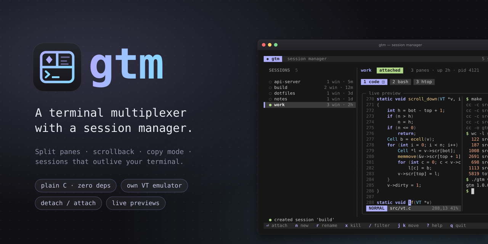
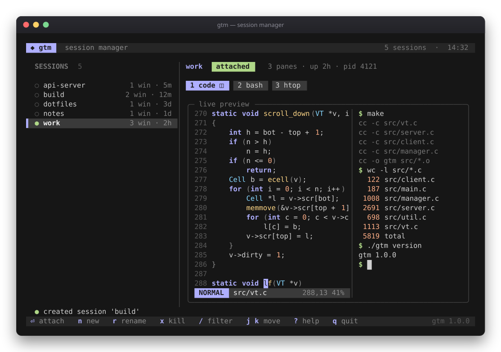

<p align="center">
  
</p>

# gtm

**gtm is a terminal multiplexer, like tmux or GNU screen, written from scratch
in about 6,000 lines of plain C. It comes with a full-screen session manager.**

You run shells inside gtm *sessions*. A session keeps running in the background
after you close the terminal, so you can detach and reattach later. Each session
has windows (tabs), windows split into panes, and every pane has scrollback, a
vim-style copy mode, and search.

Run `gtm` with no arguments and you get an
[nnn](https://github.com/jarun/nnn)-style session manager: every session in a
list, a **live preview** of the selected one, and single keys to attach (`⏎`),
create (`n`), rename (`r`) and kill (`x`). Detaching drops you back into the
manager instead of the shell.

<p align="center">
  
</p>

- **Zero dependencies.** Only libc: no ncurses, no libevent. gtm has its own
  VT100/xterm emulator (256 and true colour, wide characters, alt screen) and
  its own diff-based renderer.
- **Sessions are daemons.** Each one is a small process on a unix socket, so it
  survives a closed terminal, an SSH drop, or a crashed window manager.
- **Discoverable keys.** The prefix is `Esc`, not `Ctrl-b`. Press it and a menu
  lists what every next key does. Built-in aliases cover desktop setups where
  `Ctrl-b` is taken.
- **Clipboard that works.** Copy mode sends text to OSC 52 *and* `wl-copy` /
  `xclip` / `xsel`, so `Ctrl-Shift-v` pastes it even in GNOME Terminal.

## Build

```sh
make
sudo make install        # or: make install PREFIX=~/.local
```

You need a C11 compiler on Linux. gtm reads `/proc` to name windows after
their running program and to open new panes in the current directory.

## Usage

```
gtm                       open the session manager
gtm new [-d] [name]       create a session and attach (-d: stay detached)
gtm attach [name]         attach (alias: a); no name = first detached session
gtm ls                    list sessions
gtm kill <name>           end a session
gtm rename <old> <new>    rename a session
```

### Session manager keys

| key | action |
| --- | --- |
| `j` `k` `↑` `↓` `g` `G` | move |
| `⏎` `l` `→` | attach to the selected session |
| `n` `Ctrl-t` / `N` | new session and attach / new session, stay here |
| `r` | rename |
| `x` `Ctrl-w` | kill (asks y/n) |
| `/` `Ctrl-f` | filter as you type, `esc` clears |
| `R` | refresh |
| `?` | help overlay |
| `q` `Esc` `Esc` | quit |

Detaching from a session (`Esc d`) returns you to the manager.

### Inside a session (prefix `Esc`)

Press `Esc` and a menu pops up above the status bar listing what each
next key does, grouped into session, windows, panes and copy & paste. Press one
of the listed keys to run it, or `q` to close the menu. Press `Esc` twice to
go back to the session manager (and `Esc` twice there quits gtm). To send a
real `Esc` to the program (e.g. to leave insert mode in vim), press `Esc e`. The keys
are the same as before, so typing `Esc d` quickly still detaches. The status bar
always shows `Esc d detach` right after the window tabs, so the way out is always
on screen. On wide terminals it also shows `Esc menu`.

Only a lone `Esc` press counts as the prefix. Arrow keys, function keys, Alt-keys
and pastes also begin with an escape byte, but they arrive together with the
rest of their bytes, so they go straight to the program. In copy mode `Esc` just
leaves copy mode.


| key | action | key | action |
| --- | --- | --- | --- |
| `c` `Ctrl-t` | new window | `%` `\|` | split left / right |
| `n` `p` / `Tab` `Shift-Tab` | next / prev window | `"` `-` | split top / bottom |
| `1`…`9` | jump to window | `h j k l` / arrows | move focus |
| `,` | rename window | `H J K L` / `Ctrl`+arrows | resize pane |
| `&` | kill window | `o` `;` | next / last pane |
| `$` | rename session | `z` | zoom pane |
| `d` | detach | `x` `Ctrl-w` | kill pane |
| `s` | detach to session manager | `[` `PgUp` | copy / scroll mode |
| `r` `Ctrl-l` | redraw | `]` | paste |
| `?` | help overlay | `Ctrl-f` | search scrollback |
| `Home` `End` | first / last window | `e` | send the prefix itself |

With a prefix other than `Esc`, pressing it twice also sends it, as in tmux.

### Changing the prefix

The prefix is `Esc`. gtm doesn't use tmux's `Ctrl-b` because desktop
shortcuts often grab it (on Cinnamon it can be bound to a launcher, and then the
terminal never sees it). Set `GTM_PREFIX` before starting a session to pick
another, e.g. `export GTM_PREFIX=C-space` in `~/.bashrc`. It accepts `esc`, `C-space`,
`C-a` … `C-z`, `C-\`, `C-]`, `C-^` and `C-_` (`^a` works too). The prefix is
read when a session starts, so sessions that are already running keep their old one.

The control-key aliases above (`Ctrl-t`, `Ctrl-w`, `Ctrl-f`, `Tab`, `Ctrl`+arrows,
`Home`/`End`) are there so key remappers that turn Alt-combos into browser-style
shortcuts (Alt+i → Ctrl-t, Alt+o → Ctrl-Tab, Alt+. → Ctrl-w, Alt+f → Ctrl-f,
Alt+w/b → Ctrl+arrows, Alt+n/m → Home/End, Alt+c → Ctrl-c) work as expected in gtm.

**Copy mode:** `hjkl`/arrows move, `Ctrl-u`/`Ctrl-d`/`PgUp`/`PgDn` scroll,
`g`/`G` go to the top/bottom of history, `w`/`b` or `Ctrl`+arrows move by word, `v` or `space`
start a selection, `V` selects whole lines, `y`/`⏎`/`Ctrl-c` copy and exit, `/` or
`Ctrl-f` searches upward, `n`/`N` repeat the search, `q` quits. Copied text goes to gtm's paste
buffer (`Esc ]`). It's also sent to your system clipboard: via OSC 52 if
your terminal supports it, and via `wl-copy`, `xclip` or `xsel` if one is
installed (GNOME Terminal ignores OSC 52, so this is what makes `Ctrl-Shift-v`
paste it).

## How it works

- Each session is a small daemon listening on a unix socket in
  `$XDG_RUNTIME_DIR/gtm/<name>` (override with `$GTM_DIR`). That's why
  sessions survive closing your terminal.
- The daemon runs every pane's shell on a pty. It feeds the output through a
  built-in VT100/xterm emulator (`src/vt.c`) with 256 and true colour, wide
  characters, alt screen, scroll regions, and 5000 lines of scrollback.
- It composes windows, borders, and the status bar into one frame and sends
  each attached client only the cells that changed. Rendering is capped at
  about 120 fps, so heavy output stays cheap.
- The session manager asks each daemon for a status summary and a rendered
  snapshot of its active window, which becomes the live preview.
- Panes get `TERM=screen-256color`, plus `$GTM`, `$GTM_SESSION` and
  `$GTM_PANE`. Attaching from inside a session is refused to prevent
  accidental nesting. Set `GTM_FORCE_NEST=1` to allow it.

| file | |
| --- | --- |
| `src/vt.c` | terminal emulator |
| `src/server.c` | session daemon: panes, layout tree, rendering, keys, copy mode |
| `src/client.c` | attach client |
| `src/manager.c` | session manager TUI |
| `src/util.c` | protocol, sockets, utf-8, keys, helpers |
| `src/main.c` | command line |

## License

MIT. See [LICENSE](LICENSE).
